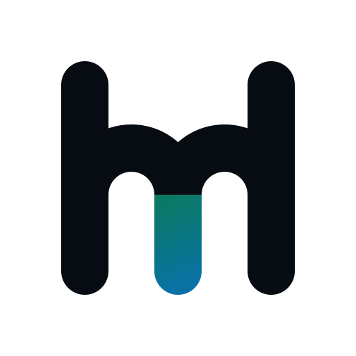
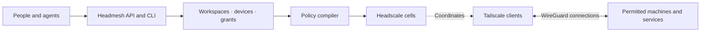

<picture>
  <source media="(prefers-color-scheme: dark)" srcset="https://raw.githubusercontent.com/headmesh-dev/.github/main/profile/assets/mark-dark.svg" />
  
</picture>

# Headmesh

### Share machines, not your network.

Open, self-hostable, multi-tenant networking built on Headscale and WireGuard.

[Website and early access](https://headmesh.dev/) · [Documentation](https://headmesh.dev/docs/) · [Source](https://github.com/headmesh-dev/headmesh) · [Agent plugins](https://github.com/headmesh-dev/headmesh/tree/main/plugins)

## Access with a scope and an end time

Headmesh adds a sharing and tenancy layer around Headscale and the official Tailscale clients. Give a teammate, renter or AI agent access to the machines and services they need, with workspace boundaries and explicit permissions.

| Capability | What it means |
| --- | --- |
| **Separate workspaces** | Organisations have their own members, devices and access policies. |
| **Device onboarding** | Invite links and CLI workflows enrol devices into the right workspace. |
| **Temporary grants** | Share a machine or port for a defined time, with automatic expiry. |
| **Agent sandboxes** | Connect agents to a sandbox on your hardware, with scoped mounts and granted services. |
| **Self-hosting** | Run the control plane and its Headscale cells on infrastructure you control. |

Headmesh supplies the control layer. Headscale and Tailscale provide mesh coordination and connectivity; WireGuard carries the encrypted connections.

## For teams, compute renters and AI agents

The project includes a **Go control plane and CLI**, **cell agents**, a separate **agent sandbox**, and **Claude Code/Codex plugins**. It is built for [Xcelsior Compute](https://xcelsior.ca/)'s GPU-sharing workflow: access scoped to the rented machine and rental period.

Headmesh remains **pre-release**, with early access through the [waitlist](https://headmesh.dev/). The CLI, sandbox, plugins and web code use **Apache-2.0**; the server and cell-agent implementation use **AGPL-3.0-only**. See the [licensing map](https://github.com/headmesh-dev/headmesh/blob/main/LICENSING.md) for path-specific terms.

**[Read the quickstart](https://headmesh.dev/docs/quickstart/) · [Explore the code](https://github.com/headmesh-dev/headmesh) · [Read the docs as Markdown](https://headmesh.dev/llms.txt)**
